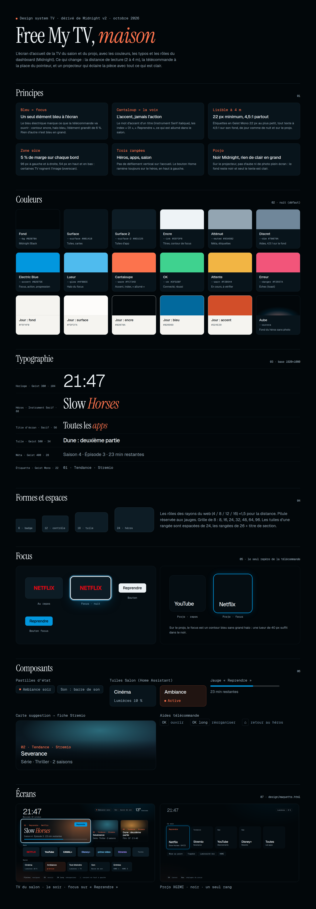

# Design system TV (maison)

L'écran d'accueil de la TV du salon et du projo, dérivé de **Midnight v2**, le design system du dashboard
(`raphlopes/nefarx-dashboard`, `src/design-system/`). Même nuancier, mêmes rôles de couleur, mêmes typos. Seules les
tailles changent, pour une lecture à 2–4 m et une navigation à la télécommande.

| Fichier | Contenu |
|---|---|
| [`tokens.css`](tokens.css) | Jetons : couleurs (nuit, jour, projo), typo TV, rayons, espaces, focus |
| [`components.css`](components.css) | Composants `tv-` : héros, carte, tuile d'app, tuile Salon, pastille, bouton, jauge, aides |
| [`design-system.html`](design-system.html) | La planche ci-dessus, vivante |
| [`maquette.html`](maquette.html) | Les écrans 1920×1080 : `#tv` (salon) et `#projo` (XGIMI) |
| `fonts/` | Geist, Geist Mono, Instrument Serif (licence OFL, fichiers `OFL-*.txt`) |

## Les règles

- **Bleu = focus.** Electric Blue `#0297DE` marque le seul élément que la télécommande va ouvrir : contour encre,
  halo bleu, +6 %. Rien d'autre n'est bleu en grand.
- **Cantaloup = la voix.** `#FC734D` pour le mot d'accent des titres (Instrument Serif italique), les index « 01 »,
  « Reprendre » et ce qui est allumé dans le salon. Jamais pour une action.
- **Lisible à 4 m.** Pas de texte sous 22 px (étiquettes en Geist Mono), et 4,5:1 minimum sur son fond, de nuit, de
  jour et sur le projo.
- **Zone sûre de 5 %** : 96 px sur les côtés, 54 px en haut et en bas.
- **Trois rangées** (héros, apps, salon), sans défilement vertical. Home ramène sur le héros.
- **Projo : noir Midnight**, sans photo plein écran ni aube : l'image éclaire la pièce.

## Vers le code

`HomeView.java` dessine à la main sur un Canvas : ces fichiers disent **quoi** dessiner, ils ne sont pas embarqués.
Les valeurs passent telles quelles dans `HomeView.makePaints()` (couleurs, tailles ×`k` pour une UI en 1280×720),
et les polices doivent être ajoutées en `.ttf` dans `app/assets/fonts/`.

Rendu des images : `google-chrome --headless=new --window-size=1920,1080 --screenshot=maquette-tv.png "file://$PWD/maquette.html#tv"`.
