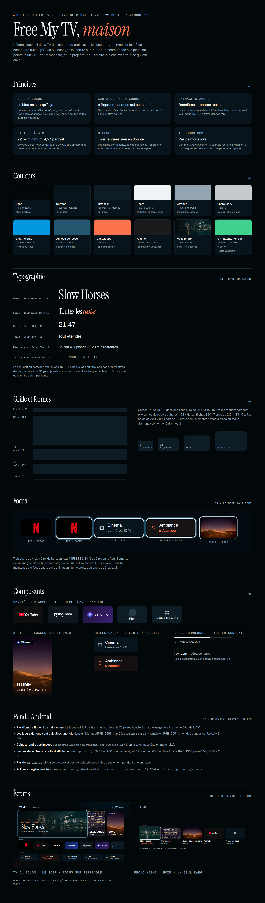
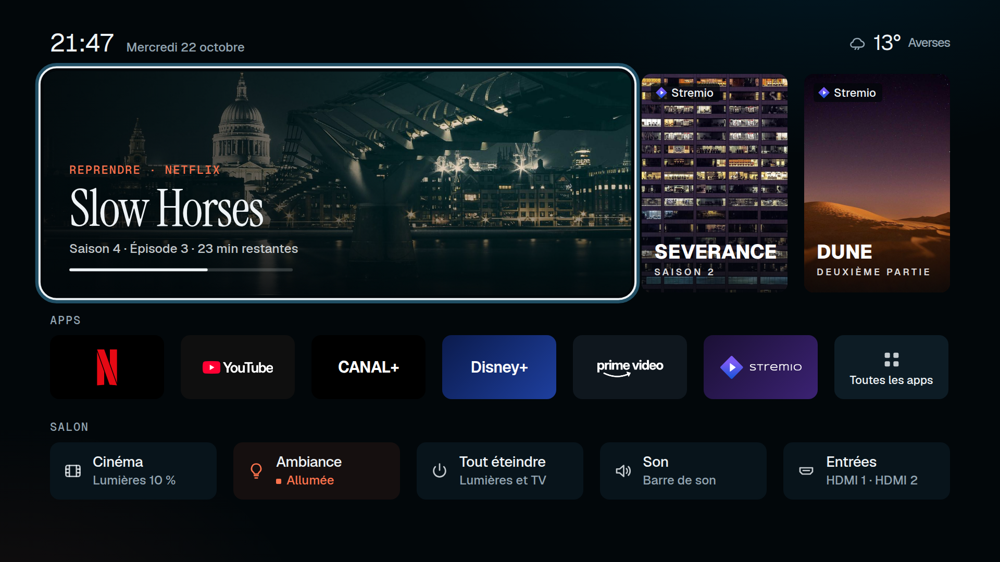
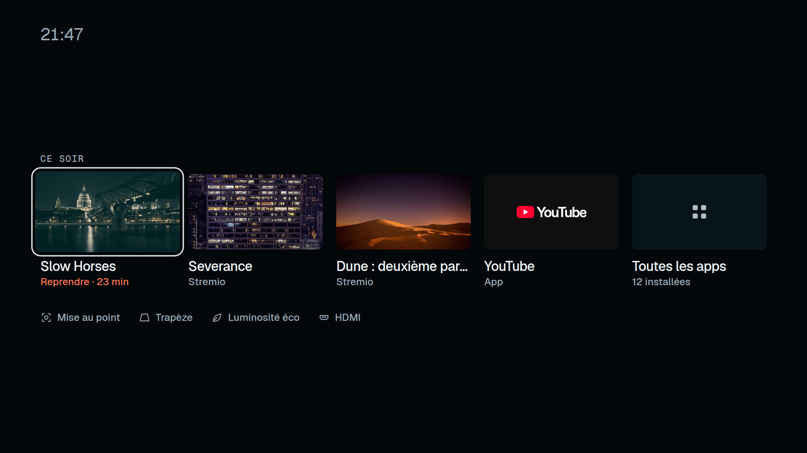

# Design system TV (maison)

L'écran d'accueil de la TV du salon et du projo, dérivé de **Midnight v2**, le design system du dashboard
(`raphlopes/nefarx-dashboard`, `src/design-system/`). Même nuancier, mêmes rôles de couleur, mêmes typos. Seules les
tailles changent, pour une lecture à 2–4 m, une navigation à la télécommande et un GPU de TV.

| Fichier | Contenu |
|---|---|
| [`tokens.css`](tokens.css) | Jetons : couleurs, focus, typo TV, rayons, grille ; variante projo |
| [`components.css`](components.css) | Composants `tv-` : en-tête, héros, affiche, bannière d'app, tuile Salon, vignette projo, jauge, aide |
| [`design-system.html`](design-system.html) | La planche ci-dessus, vivante |
| [`maquette.html`](maquette.html) | Les écrans 1920×1080 : `#tv` (salon) et `#projo` (XGIMI) |
| `fonts/` | Geist, Geist Mono, Instrument Serif (licence OFL, fichiers `OFL-*.txt`) |
| `img/` | Photos des maquettes (Unsplash, voir [`img/CREDITS.md`](img/CREDITS.md)) |

## Les règles

- **Bleu = focus, et rien d'autre.** Un seul élément sélectionné, toujours dessiné pareil : trait encre de 4 px à
  6 px du bord, anneau `#4FBBEE` à 40 % de 6 px, sans flou. L'élément grandit de 12 px par côté
  (`échelle = 1 + 24 / largeur`). 150 ms ; touche maintenue : pas d'animation. Projo : trait encre de 3 px seul.
- **Cantaloup = en cours** : « Reprendre » et ce qui est allumé dans le salon. Pas d'index décoratifs, jamais de mot
  coloré dans un titre de film.
- **L'image d'abord** : bannière Android TV de l'app (`getApplicationBanner`), image et logo du titre TMDB. Le texte
  est un repli.
- **Lisible à 4 m** : Geist 500 pour tout ce qui se lit (24 px), Geist Mono en capitales seulement pour les titres de
  section (22 px, le plancher), 4,5:1 minimum.
- **Silence** : trois rangées (héros, apps, salon), rien en double, pas d'aide permanente (une aide en contexte, 4 s).
- **Toujours sombre**, pas de mode jour. Le projo reste noir Midnight, sans grande surface claire.

## Grille de l'écran TV

Contenu 1728 × 972 (zone sûre 96 / 54). En-tête 56 · 32 · héros 420 · 40 · Apps · 40 · Salon. Héros 1104 + deux
affiches 280 ; 7 apps 219 × 123 ; 5 tuiles Salon 320 × 110 ; écart 32 partout (la place du focus).

## Vers le code (HomeView, Canvas)

Ces fichiers disent **quoi** dessiner ; rien n'est embarqué. Valeurs ×`k` sur une UI en 1280×720.

- Focus en traits, pas d'ombre floue ni de halo animé.
- Lueurs du fond calculées une fois dans un bitmap ARGB_8888 tramé (`setDither(true)`), jamais en RGB_565.
- Coins des images par `BitmapShader` + `drawRoundRect`, pas `clipPath`.
- Images décodées à la taille d'affichage (`inSampleSize`) : TMDB w1280 pour le héros, w342 pour les affiches.
- Pas de `saveLayer`, pas de redessin hors animation.
- Polices en `.ttf` dans `app/assets/fonts/`, chargées une fois dans `makePaints()`.

Rendu des images : `google-chrome --headless=new --window-size=1920,1080 --screenshot=maquette-tv.png "file://$PWD/maquette.html#tv"`.
